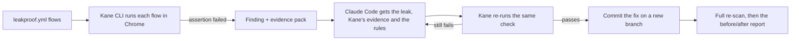

# Leakproof

**Find the leaks a screenshot can't see. Have your coding agent fix them. Make Kane prove every fix.**

Your app can look perfect and still leak. A session cookie readable by any script. An API key in `localStorage`. A request failing with a 500 behind a page that renders fine. Production code calling a staging server. AI coding agents ship these all the time, because they check what the page *looks* like.

Leakproof walks your app's real user flows in a real browser with [Kane CLI](https://github.com/LambdaTest/kane-cli), checks the things users never see, and hands each leak to Claude Code with Kane's evidence. A fix counts only when Kane re-runs the same check and it passes.

```
leakproof  scanning http://localhost:3000  ·  6 checks across 3 flows

  LEAK   home          Hidden server errors  GET /api/recommendations returned 500
  LEAK   home          Slow requests         GET / took 1526 ms (document)
  LEAK   add-to-cart   Console errors        Cannot read properties of undefined (reading 'track')
  LEAK   checkout      Cookie flags          Authentication cookie lacks HttpOnly protection
  LEAK   checkout      Secrets in storage    localStorage holds a token and a live key
  LEAK   checkout      Environment leaks     POST http://staging.localhost:3000/api/collect

  6 leaks found  ·  141 credits  ·  2m 4s
```

## What it checks

| Check | What it catches | What Kane looks at |
|---|---|---|
| `cookies` | Session cookies without `HttpOnly` or `Secure` | The browser's cookie jar, including HttpOnly cookies |
| `storage` | Tokens, JWTs and `sk_live_` keys in `localStorage` | `localStorage` keys and values |
| `network` | Requests failing with 5xx behind a page that looks fine | Every request in the step |
| `console` | Errors thrown by a click or a page load | The console, minus resource-load noise |
| `env-leak` | Calls to `staging`, `dev`, `internal` or `localhost` hosts from production code | Request hosts, minus your app's own |
| `vitals` | Pages, images or API calls slower than your budget | Request timings in the step |

## How the loop works



Every finding comes from a Kane verdict. Leakproof reads Kane's `.evidence` pack for the exact readings: the HAR line, the console error and the screenshot of the failing step. It never relies on the agent saying "done".

## Quick start

You need Node 20+, [Kane CLI](https://www.testmuai.com/support/docs/kane-cli-introduction/) and, for `fix`, the [Claude Code](https://docs.anthropic.com/en/docs/claude-code) CLI.

```bash
npm install -g @testmuai/kane-cli
kane-cli login
```

Run it straight from GitHub (it builds on install):

```bash
npx github:MohitGoyal09/leakproof init     # writes leakproof.yml
npx github:MohitGoyal09/leakproof scan     # find leaks, write .leakproof/report.html
npx github:MohitGoyal09/leakproof fix      # fix each leak with Claude Code, prove each fix with Kane
```

Or clone it:

```bash
git clone https://github.com/MohitGoyal09/leakproof && cd leakproof
npm install && npm link    # gives you the `leakproof` command
```

`fix` needs the Claude Code CLI logged in (run `claude`, then `/login`).

## leakproof.yml

```yaml
url: http://localhost:3000
start: npm run build && npm run start   # optional
env: [SHOP_USER, SHOP_PASS]             # read from your environment
checks:
  vitals: { slow_ms: 1000 }
flows:
  - name: checkout
    checks: [cookies, storage, env-leak]
    steps:
      - Open /login and sign in with username {{SHOP_USER}} and password {{SHOP_PASS}}
      - Open /checkout and wait for the order summary to appear
```

Steps are plain English. Checks whose browser capture resets every step (`network`, `console`, `env-leak`, `vitals`) are asserted on every step. `cookies` and `storage` are asserted on the last step. You can also place a check on a step with `{ do: "...", checks: [network] }`.

## Try it on the leaky shop

`examples/shop` is Driftwood Supply, a fictional Next.js store that looks finished and hides six planted leaks, one per check. `examples/shop.fixed.patch` is a hand-made fix, used to prove Leakproof reports zero on a healthy app.

```bash
bash scripts/demo.sh scan   # 6 leaks
bash scripts/demo.sh fix    # 6 → 0, each fix proven by Kane
```

## Safety rules

- `fix` refuses to start on a dirty git tree, and works on a new branch `leakproof/fix-<timestamp>`, one commit per proven fix.
- The agent may not edit `leakproof.yml`. If it does, the attempt is rejected and reverted.
- A failed attempt is reverted before the next one. After 3 attempts the leak is reported as still leaking.
- Credentials go to Kane through a temporary variables file (mode 0600, deleted after the run). They never appear in objectives, prompts, the terminal or the report.
- Text from the scanned page is escaped in the HTML report and stripped of control characters in the terminal.

## Cost

Each check is one Kane run of about 7–30 credits (about 20 on average) and 50–110 seconds. Runs go 4 at a time. A full scan of the demo shop costs about 120–140 credits.

## Development

```bash
npm install
npm test          # 90+ tests, Kane and Claude replaced by fakes in test/fixtures
npm run build
```

Built for the KaneCLI Online Hackathon (November 2026). Verified with Kane CLI.

## License

MIT
