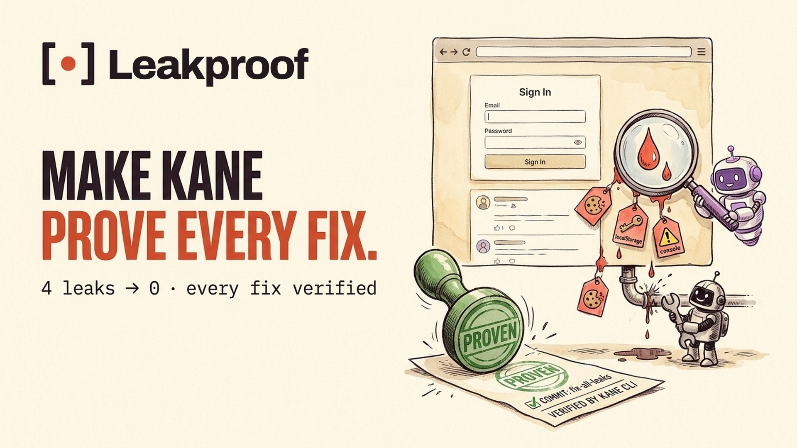
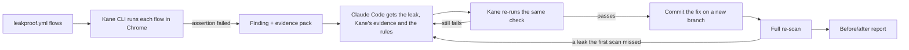

# Leakproof

**Find the leaks a screenshot can't see. Have your coding agent fix them. Make Kane prove every fix.**

[](https://youtu.be/nYUhKqHw_qA)

**[Watch the 3-minute demo](https://youtu.be/nYUhKqHw_qA)**: one real `leakproof fix` run on an open-source app we didn't write (4 → 0 leaks), a fix Kane rejected and the retry it proved, and the guard tests that stop the agent from cheating. The write-up: [dev.to](https://dev.to/mohit_goyal_d1ed585c68889/claude-code-fixed-4-leaks-in-an-app-i-didnt-write-kane-proved-every-fix-21a7).

[Demo video](https://youtu.be/nYUhKqHw_qA) · [For judges](#for-judges) · [What it checks](#what-it-checks) · [How the loop works](#how-the-loop-works) · [Quick start](#quick-start) · [In CI](#in-ci-github-actions) · [Safety rules](#safety-rules) · [Limits](#limits)

Your app can look perfect and still leak. A session cookie readable by any script. An API key in `localStorage`. A request failing with a 500 behind a page that renders fine. Production code calling a staging server. AI coding agents ship these all the time, because they check what the page *looks* like.

Leakproof walks your app's real user flows in a real browser with [Kane CLI](https://github.com/LambdaTest/kane-cli), checks the things users never see, and hands each leak to Claude Code with Kane's evidence. A fix counts only when Kane re-runs the same check and it passes.

**Results from real runs:** on a real open-source app we did not write ([cypress-realworld-app](docs/real-world/cypress-rwa/)), Kane found 2 leaks, fixing them uncovered a third, and all 3 were fixed (3 → 0); on our demo shop with six planted leaks ([sample run](docs/sample-run/)), 6 → 0. Every fix is proven by a Kane re-run, and every false alarm and half-fix is shown.

## For judges

| Criterion | Where to check it |
|---|---|
| See it run (3 min) | [Demo video on YouTube](https://youtu.be/nYUhKqHw_qA): every number in it comes from a recorded run |
| Works end to end | `bash scripts/real-world.sh scan` (a real app) or `bash scripts/demo.sh fix` (the demo shop) |
| Kane caught or proved something | Real app: [docs/real-world/cypress-rwa](docs/real-world/cypress-rwa/) (2 real React errors, a missing Secure flag; a re-scan with the wider storage check also caught the signed-in user's state in `localStorage`, each leak confirmed by two Kane runs). A later `fix` run took the real app 4 → 0, every fix passing Kane twice, with our review of each fix: [fix-2026-11-24](docs/real-world/cypress-rwa/fix-2026-11-24/) Demo: [docs/sample-run](docs/sample-run/) (6 → 0) |
| The agent and Kane talk | The prompts the agent got, with Kane's evidence: [real app](docs/real-world/cypress-rwa/prompts/), [demo](docs/sample-run/prompts/). Kane's re-run verdict goes back on a fail ([How Kane and the agent talk](#how-the-loop-works)) |
| Verified | Each report links the failing Kane run and the Kane run that proves the fix: [real app report](docs/real-world/cypress-rwa/report.html), [demo report](docs/sample-run/report.html) |
| Closed loop | Kane rejected one of the agent's fixes and its verdict went back to the agent, whose second attempt passed ([the retry prompt](docs/sample-run/prompts/checkout__cookies.2.txt), [terminal.txt](docs/sample-run/terminal.txt)). One commit per proven fix ([commits](docs/real-world/cypress-rwa/commits.txt)); a leak hidden behind another was caught by the re-scan and fixed in the same run ([terminal.txt](docs/real-world/cypress-rwa/terminal.txt)) |
| The agent cannot cheat | Guard tests in [test/fixer.test.ts](test/fixer.test.ts): git commits, gitignored files, build config, deleting the failing request, secrets in its environment |
| Honest limits | [Limits](#limits), the [control runs](docs/sample-run/control.txt) with one Kane false alarm, and what Leakproof [missed on the real app](docs/real-world/cypress-rwa/README.md#what-leakproof-missed-here) |
| Check without credits | Open the two `report.html` files, read `terminal.txt` and `fixes.patch` in each folder, run `npm test` |

```
leakproof  scanning http://localhost:3000  ·  6 checks across 3 flows

  LEAK   home          Hidden server errors  GET /api/recommendations returned 500
  LEAK   home          Slow requests         GET /?_rsc=NBYwLSnedbI3BPhy took 1503 ms (fetch)
  LEAK   checkout      Secrets in storage    Authentication token stored in localStorage
  LEAK   checkout      Environment leaks     POST http://staging.localhost:3000/api/collect
  LEAK   checkout      Cookie flags          Login cookie is missing the HttpOnly flag
  LEAK   add-to-cart   Console errors        Cannot read properties of undefined (reading 'track')

  6 leaks found  ·  167 credits  ·  3m 25s
```

This is a real scan of the demo shop: [docs/sample-run/scan.txt](docs/sample-run/scan.txt).

Then `leakproof fix` on the same shop, a real run with Claude Code (Opus 5.5):

```
  Exhibit A  Hidden server errors · home  Recommendations API returns 500 on home page load
    attempt 1  edited app/api/recommendations/route.ts  → Kane re-run passed  FIXED
  ...
  Re-scanning every flow to catch regressions

  PASS   home          Hidden server errors
  PASS   home          Slow requests
  PASS   checkout      Cookie flags
  PASS   checkout      Secrets in storage
  PASS   add-to-cart   Console errors
  PASS   checkout      Environment leaks

  6 → 0 leaks  ·  6 fixes verified by Kane  ·  332 credits  ·  18m 38s
```

The full output, the report with the Kane run that proves each fix, the prompts the agent got, its patch and a review of each fix are in [docs/sample-run](docs/sample-run/).

## What it checks

| Check | What it catches | What Kane looks at |
|---|---|---|
| `cookies` | Session cookies without `HttpOnly` or `Secure` | The browser's cookie jar, including HttpOnly cookies |
| `storage` | Tokens, JWTs, `sk_live_` keys and auth state in `localStorage` or `sessionStorage` | Keys (`token`, `secret`, `api_key`, `auth`, `jwt`, `password`) and values (`eyJ…`, `sk_live_…`) in both stores |
| `network` | Requests failing with 5xx behind a page that looks fine | Every request in the step |
| `console` | Errors thrown by a click or a page load | The console, minus resource-load noise |
| `env-leak` | Calls to `staging`, `dev`, `internal` or `localhost` hosts from production code | Request hosts, minus your app's own |
| `vitals` | Pages, images or API calls slower than your budget | Request timings in the step |

A failed check is not trusted on one run. Kane runs it again; if the two runs disagree, a third run decides. In `fix`, a fix's passing re-run is checked the same way, so one lucky Kane run does not become a commit. A one-off wrong failure therefore cannot invent a leak or block a fix, and the report lists every split verdict ("failed 1 of 3 runs, not counted"). A first scan run that wrongly passes is not re-checked (that would double every scan). `--no-confirm` counts a single run.

## How the loop works



Every finding comes from a Kane verdict. Leakproof reads Kane's `.evidence` pack for the exact readings: the HAR line, the console error and the screenshot of the failing step. It never relies on the agent saying "done".

How Kane and the agent talk:

- **Kane → agent:** the failed assertion, the evidence from the pack, and Kane's diagnosis and suggestion go into the agent's prompt, marked as untrusted data.
- **Agent → Kane:** every edit restarts the app and triggers a Kane re-run of the same check. A fail is reverted, and Kane's new verdict goes into the next prompt.
- **Kane is non-deterministic, and fixes can collide.** A check can pass in one run and fail in the next, and a later fix can break an earlier one. If the full re-scan finds a leak the first scan missed, or a fixed leak that came back, that leak goes through the same fix loop once more, and Kane scans every flow again. A fix counts only if the last scan no longer finds the leak.
- Every prompt the agent got is saved in `.leakproof/prompts/`, and the report links the Kane run that proves each fix.

**Lessons memory: it learns from Kane across runs.** After each `fix` run, Leakproof saves what Kane taught it to `.leakproof/lessons.json`: every edit Kane rejected (the diff and Kane's reason) and every fix Kane proved (its commit, kept only when the final scan agrees). The next run gives the agent the lessons for the same check, the same leak first, so it does not repeat a fix Kane already turned down. The `fix` summary says how many lessons it used and learned, and the report lists them under "What Kane taught Leakproof". A later `scan` that finds a leak Kane proved fixed before says so, with the commit that fixed it. Delete the file to start fresh. Lessons help only after Kane rejects an edit: in 4 runs of the cookie check alone on 22 Nov 2026 (`bash scripts/demo.sh learn`, 129 credits), Claude Code fixed the leak on the first try each time, so there was nothing to correct. Kane rejected the first cookie fix in the [sample run](docs/sample-run/) on 21 Nov.

## Quick start

You need Node 20+, [Kane CLI](https://www.testmuai.com/support/docs/kane-cli-introduction/) and, for `fix`, the [Claude Code](https://docs.anthropic.com/en/docs/claude-code) CLI.

```bash
npm install -g @testmuai/kane-cli
kane-cli login
```

Run it straight from GitHub (it builds on install):

```bash
npx github:MohitGoyal09/leakproof init     # writes leakproof.yml
npx github:MohitGoyal09/leakproof scan     # find leaks, write .leakproof/report.html
npx github:MohitGoyal09/leakproof fix      # fix each leak with Claude Code, prove each fix with Kane
```

Or clone it:

```bash
git clone https://github.com/MohitGoyal09/leakproof && cd leakproof
npm install && npm link    # gives you the `leakproof` command
```

`fix` needs the Claude Code CLI logged in (run `claude`, then `/login`). To run the agent another way (a different account, model or tool list), point `LEAKPROOF_CLAUDE_BIN` at a script that passes its arguments on to `claude`.

## In CI (GitHub Actions)

```yaml
- uses: MohitGoyal09/leakproof@main
  with:
    kane-username: ${{ secrets.KANE_USERNAME }}
    kane-access-key: ${{ secrets.KANE_ACCESS_KEY }}
    working-directory: .          # where leakproof.yml and its start command live
    fail-on-leaks: "true"         # "false" reports leaks without failing the job
  env:
    SHOP_PASS: ${{ secrets.SHOP_PASS }}   # every variable leakproof.yml lists under env
```

Each leak shows as an error on the run, the job summary gets a table with a link to each Kane run, and `report.html` and `findings.json` are uploaded as an artifact. The `leaks` output holds the count. [.github/workflows/demo-scan.yml](.github/workflows/demo-scan.yml) runs it on the demo shop (manual only, since every run spends Kane credits). The Action logs in with `kane-cli login --username --access-key` (Kane takes the key only as an argument) and logs out when the job ends; pass `kane-project-id` and `kane-folder-id` if your account would otherwise ask for them. It has not yet had a run on GitHub.

## leakproof.yml

```yaml
url: http://localhost:3000
start: npm run build && npm run start   # optional
env: [SHOP_USER, SHOP_PASS]             # read from your environment
checks:
  vitals: { slow_ms: 1000 }
flows:
  - name: checkout
    checks: [cookies, storage, env-leak]
    steps:
      - Open /login and sign in with username {{SHOP_USER}} and password {{SHOP_PASS}}
      - Open /checkout and wait for the order summary to appear
```

Steps are plain English. Checks whose browser capture resets every step (`network`, `console`, `env-leak`, `vitals`) are asserted on every step. `cookies` and `storage` are asserted on the last step. You can also place a check on a step with `{ do: "...", checks: [network] }`.

## Try it on the leaky shop

`examples/shop` is Driftwood Supply, a fictional Next.js store that looks finished and hides six planted leaks, one per check. `examples/shop.fixed.patch` is a hand-made fix, used to prove Leakproof reports zero on a healthy app.

```bash
bash scripts/demo.sh scan   # 6 leaks
bash scripts/demo.sh fix    # 6 → 0, each fix proven by Kane
bash scripts/demo.sh control   # the shop fixed by hand: 0 leaks
```

To run it on a real app instead, `bash scripts/real-world.sh scan|fix` clones [cypress-realworld-app](https://github.com/cypress-io/cypress-realworld-app) at a pinned commit and runs Leakproof on it with [this config](docs/real-world/cypress-rwa/leakproof.yml). Results: [docs/real-world/cypress-rwa](docs/real-world/cypress-rwa/).

## Safety rules

- `fix` refuses to start on a dirty git tree, and works on a new branch `leakproof/fix-<timestamp>`, one commit per proven fix. Only Leakproof commits, and only the files Kane checked.
- A hidden 500 or a slow request cannot be "fixed" by deleting the request: after a passing re-run, every request Kane named must still appear in that run's network log, and succeed.
- A console error cannot be "fixed" by hiding it: an edit that removes a `console.error` call, replaces `console`, adds an empty `catch` or a global error handler is rejected before Kane runs.
- If the agent runs git itself (a commit, a branch switch, a hidden-file flag or an edit to `.git/config`), the attempt is rejected and git is put back. Leakproof's own git commands run with hooks and fsmonitor turned off, so files the agent writes under `.git` never run.
- The agent runs without the `env:` secrets and without Kane, TestMu AI or CI credentials (`KANE_*`, `LT_*`, `LAMBDATEST_*`, `TESTMU_*`, `ACTIONS_*`, `GITHUB_TOKEN`, `GH_TOKEN`) in its environment.
- The agent may not edit `leakproof.yml`, `package.json`, lockfiles, `tsconfig*.json` or `*.config.*` files. If it does, the attempt is rejected and reverted.
- A fix hidden in gitignored files (such as `.env.local`) cannot pass: Leakproof stops the app, snapshots those files before each attempt and puts them back before Kane re-checks, since they would never reach the commit. Build output and `node_modules` are not watched.
- If Kane or the agent fails hard mid-fix (for example a logged-out CLI), or you press Ctrl-C, the unproven edit is reverted.
- A failed attempt is reverted before the next one. After 3 attempts the leak is reported as still leaking.
- Credentials go to Kane through a temporary variables file (mode 0600, deleted after the run, also on Ctrl-C). Their values are masked (as typed, JSON-escaped and URL-encoded) in prompts, logs, the terminal and the report. Screenshots in the evidence pack can still show what the page displayed.
- Lessons are fenced as untrusted data in the prompt, like Kane's evidence, with secret values masked. Leakproof reads `lessons.json` before the agent runs and writes it back from memory at the end, so an agent cannot plant lessons for the next run.
- Text from the scanned page is escaped in the HTML report and stripped of control characters in the terminal.
- `leakproof.yml` is code: `start` runs in a shell, and `env` names the variables sent to Kane. Read a cloned project's config before you run it.
- Without a `start` command, Leakproof cannot restart your app after an edit. Use a dev server with hot reload, or set `start`.

## Limits

- The checks are assertions in plain English that Kane checks with a browser and a model. They are broad on purpose, so they can flag harmless things (a third-party cookie without `HttpOnly`, a `Secure` flag missing on plain-http localhost, a key named `token` that holds no secret) and miss others (4xx errors, hosts named `qa.` or `uat`). The `auth` key word also flags harmless keys such as `authorName`.
- Step-scoped checks pass when nothing matching happens in the step. For `network` and `vitals`, Leakproof checks the passing re-run's own network log: every request Kane named must still happen and succeed, so deleting it does not count. For `console`, Leakproof rejects an edit, before Kane runs, that hides the error instead of fixing it: it removes a `console.error` call (even a stray debug one: keep it, fix the cause), replaces `console` or one of its methods, adds an empty `catch`, adds a global error handler or adds `suppressHydrationWarning`. New files are read too, and a new symlink, nested repository or file over 2 MB is rejected, because Leakproof cannot check it. This is a line-by-line text match, so a disguised edit (an aliased `console`, a `catch` split over lines, a logger wrapper, a deleted feature) can still get past it. Read the fix commits.
- Each fix is re-checked alone. Other checks are re-run in the full re-scan. A leak that comes back gets one more fix pass; there is no third round, and a regression is never reverted automatically.
- Gitignored files are compared with their state just before each attempt, while the app is stopped. If the agent changes one that is over 1 MB, it cannot be put back, so the run stops. Without a `start` command Leakproof cannot stop your app, so files your app writes during an attempt count as the agent's. Build output folders (`dist`, `build`, `out`, `.next`) and dependency folders are not watched.
- The build-file guard knows the JavaScript ecosystem (`package.json`, lockfiles, `tsconfig*.json`, `*.config.*`). It does not know `Dockerfile`, `Makefile`, `.npmrc` or files of other ecosystems.
- Only Claude Code is supported as the agent.
- Lessons stay on your machine in `.leakproof/` and are not committed. A rejected edit's diff covers changed tracked files only, not new files, and is cut at 1,500 characters. Leakproof keeps the newest 50 lessons.
- The evidence so far is two apps: the demo shop with six planted leaks, and one real open-source app ([cypress-realworld-app](docs/real-world/cypress-rwa/)). Kane is non-deterministic: in one run the first scan missed the console leak and only the re-scan caught it, and one of two scans of the hand-fixed shop flagged the cookie check although the cookie is set correctly ([control.txt](docs/sample-run/control.txt)). A failed check is re-run before it counts (see [What it checks](#what-it-checks)), which removes a one-off false alarm but costs one or two extra Kane runs per failure. A leak that every run misses is not reported. On the real app the first storage check missed the user's auth state in `localStorage`; the widened check (`auth` keys and `sessionStorage`) caught it in a re-scan, two runs out of two ([rescan](docs/real-world/cypress-rwa/README.md#re-scan-on-23-nov-2026-the-wider-storage-check-with-confirmed-verdicts)).

## Cost

Each check is one Kane run of about 5–30 credits (about 20 on average) and 50–110 seconds; a failed check costs one or two more runs to confirm. Runs go 4 at a time. A full scan of the demo shop costs about 100–170 credits. The full `fix` run above (scan, 6 fixes each proven by a Kane re-run, final re-scan) cost 332 credits and took 19 minutes. The total counts every Kane run.

## Development

```bash
npm install
npm test          # 230 tests, Kane and Claude replaced by fakes in test/fixtures
npm run build
```

Built for the KaneCLI Online Hackathon (November 2026). Verified with Kane CLI.

## License

MIT
