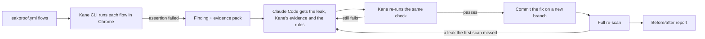

# Leakproof

**Find the leaks a screenshot can't see. Have your coding agent fix them. Make Kane prove every fix.**

Your app can look perfect and still leak. A session cookie readable by any script. An API key in `localStorage`. A request failing with a 500 behind a page that renders fine. Production code calling a staging server. AI coding agents ship these all the time, because they check what the page *looks* like.

Leakproof walks your app's real user flows in a real browser with [Kane CLI](https://github.com/LambdaTest/kane-cli), checks the things users never see, and hands each leak to Claude Code with Kane's evidence. A fix counts only when Kane re-runs the same check and it passes.

```
leakproof  scanning http://localhost:3000  ·  6 checks across 3 flows

  LEAK   home          Hidden server errors  GET /api/recommendations returned 500
  LEAK   home          Slow requests         GET / took 1526 ms (document)
  LEAK   add-to-cart   Console errors        Cannot read properties of undefined (reading 'track')
  LEAK   checkout      Cookie flags          Authentication cookie lacks HttpOnly protection
  LEAK   checkout      Secrets in storage    localStorage holds a token and a live key
  LEAK   checkout      Environment leaks     POST http://staging.localhost:3000/api/collect

  6 leaks found  ·  141 credits  ·  2m 4s
```

Then `leakproof fix` on the same shop, a real run with Claude Code (Opus 5.5):

```
  Exhibit A  Hidden server errors · home  Recommendations API returns 500 on home page load
    attempt 1  edited app/api/recommendations/route.ts  → Kane re-run passed  FIXED
  ...
  Re-scanning every flow to catch regressions

  PASS   home          Hidden server errors
  PASS   home          Slow requests
  PASS   checkout      Cookie flags
  PASS   checkout      Secrets in storage
  PASS   add-to-cart   Console errors
  PASS   checkout      Environment leaks

  6 → 0 leaks  ·  6 fixes verified by Kane  ·  248 credits  ·  17m 35s
```

The full output, the report, the screenshots and the agent's patch from this run are in [docs/sample-run](docs/sample-run/).

## What it checks

| Check | What it catches | What Kane looks at |
|---|---|---|
| `cookies` | Session cookies without `HttpOnly` or `Secure` | The browser's cookie jar, including HttpOnly cookies |
| `storage` | Tokens, JWTs and `sk_live_` keys in `localStorage` | `localStorage` keys and values |
| `network` | Requests failing with 5xx behind a page that looks fine | Every request in the step |
| `console` | Errors thrown by a click or a page load | The console, minus resource-load noise |
| `env-leak` | Calls to `staging`, `dev`, `internal` or `localhost` hosts from production code | Request hosts, minus your app's own |
| `vitals` | Pages, images or API calls slower than your budget | Request timings in the step |

## How the loop works



Every finding comes from a Kane verdict. Leakproof reads Kane's `.evidence` pack for the exact readings: the HAR line, the console error and the screenshot of the failing step. It never relies on the agent saying "done".

How Kane and the agent talk:

- **Kane → agent:** the failed assertion, the evidence from the pack, and Kane's diagnosis and suggestion go into the agent's prompt, marked as untrusted data.
- **Agent → Kane:** every edit restarts the app and triggers a Kane re-run of the same check. A fail is reverted, and Kane's new verdict goes into the next prompt.
- **Kane is non-deterministic, and fixes can collide.** A check can pass in one run and fail in the next, and a later fix can break an earlier one. If the full re-scan finds a leak the first scan missed, or a fixed leak that came back, that leak goes through the same fix loop once more, and Kane scans every flow again. A fix counts only if the last scan no longer finds the leak.
- Every prompt the agent got is saved in `.leakproof/prompts/`, and the report links the Kane run that proves each fix.

## Quick start

You need Node 20+, [Kane CLI](https://www.testmuai.com/support/docs/kane-cli-introduction/) and, for `fix`, the [Claude Code](https://docs.anthropic.com/en/docs/claude-code) CLI.

```bash
npm install -g @testmuai/kane-cli
kane-cli login
```

Run it straight from GitHub (it builds on install):

```bash
npx github:MohitGoyal09/leakproof init     # writes leakproof.yml
npx github:MohitGoyal09/leakproof scan     # find leaks, write .leakproof/report.html
npx github:MohitGoyal09/leakproof fix      # fix each leak with Claude Code, prove each fix with Kane
```

Or clone it:

```bash
git clone https://github.com/MohitGoyal09/leakproof && cd leakproof
npm install && npm link    # gives you the `leakproof` command
```

`fix` needs the Claude Code CLI logged in (run `claude`, then `/login`). To run the agent another way (a different account, model or tool list), point `LEAKPROOF_CLAUDE_BIN` at a script that passes its arguments on to `claude`.

## leakproof.yml

```yaml
url: http://localhost:3000
start: npm run build && npm run start   # optional
env: [SHOP_USER, SHOP_PASS]             # read from your environment
checks:
  vitals: { slow_ms: 1000 }
flows:
  - name: checkout
    checks: [cookies, storage, env-leak]
    steps:
      - Open /login and sign in with username {{SHOP_USER}} and password {{SHOP_PASS}}
      - Open /checkout and wait for the order summary to appear
```

Steps are plain English. Checks whose browser capture resets every step (`network`, `console`, `env-leak`, `vitals`) are asserted on every step. `cookies` and `storage` are asserted on the last step. You can also place a check on a step with `{ do: "...", checks: [network] }`.

## Try it on the leaky shop

`examples/shop` is Driftwood Supply, a fictional Next.js store that looks finished and hides six planted leaks, one per check. `examples/shop.fixed.patch` is a hand-made fix, used to prove Leakproof reports zero on a healthy app.

```bash
bash scripts/demo.sh scan   # 6 leaks
bash scripts/demo.sh fix    # 6 → 0, each fix proven by Kane
bash scripts/demo.sh control   # the shop fixed by hand: 0 leaks
```

## Safety rules

- `fix` refuses to start on a dirty git tree, and works on a new branch `leakproof/fix-<timestamp>`, one commit per proven fix. Only Leakproof commits, and only the files Kane checked.
- If the agent runs git itself (a commit, a branch switch, a hidden-file flag or an edit to `.git/config`), the attempt is rejected and git is put back. Leakproof's own git commands run with hooks and fsmonitor turned off, so files the agent writes under `.git` never run.
- The agent runs without the `env:` secrets and without Kane or TestMu AI credentials (`KANE_*`, `LT_*`, `LAMBDATEST_*`, `TESTMU_*`) in its environment.
- The agent may not edit `leakproof.yml`, `package.json`, lockfiles, `tsconfig*.json` or `*.config.*` files. If it does, the attempt is rejected and reverted.
- A fix hidden in gitignored files (such as `.env.local`) cannot pass: Leakproof stops the app, snapshots those files before each attempt and puts them back before Kane re-checks, since they would never reach the commit. Build output and `node_modules` are not watched.
- If Kane or the agent fails hard mid-fix (for example a logged-out CLI), or you press Ctrl-C, the unproven edit is reverted.
- A failed attempt is reverted before the next one. After 3 attempts the leak is reported as still leaking.
- Credentials go to Kane through a temporary variables file (mode 0600, deleted after the run, also on Ctrl-C). Their values are masked (as typed, JSON-escaped and URL-encoded) in prompts, logs, the terminal and the report. Screenshots in the evidence pack can still show what the page displayed.
- Text from the scanned page is escaped in the HTML report and stripped of control characters in the terminal.
- `leakproof.yml` is code: `start` runs in a shell, and `env` names the variables sent to Kane. Read a cloned project's config before you run it.
- Without a `start` command, Leakproof cannot restart your app after an edit. Use a dev server with hot reload, or set `start`.

## Limits

- The checks are assertions in plain English that Kane checks with a browser and a model. They are broad on purpose, so they can flag harmless things (a third-party cookie without `HttpOnly`, a `Secure` flag missing on plain-http localhost, a key named `token` that holds no secret) and miss others (4xx errors, `sessionStorage`, hosts named `qa.` or `uat`).
- Step-scoped checks pass when nothing matching happens in the step. An agent could pass `network` or `console` by removing the request instead of fixing it. Read the fix commits.
- Each fix is re-checked alone. Other checks are re-run in the full re-scan. A leak that comes back gets one more fix pass; there is no third round, and a regression is never reverted automatically.
- Gitignored files are compared with their state just before each attempt, while the app is stopped. If the agent changes one that is over 1 MB, it cannot be put back, so the run stops. Without a `start` command Leakproof cannot stop your app, so files your app writes during an attempt count as the agent's. Build output folders (`dist`, `build`, `out`, `.next`) and dependency folders are not watched.
- The build-file guard knows the JavaScript ecosystem (`package.json`, lockfiles, `tsconfig*.json`, `*.config.*`). It does not know `Dockerfile`, `Makefile`, `.npmrc` or files of other ecosystems.
- Only Claude Code is supported as the agent.
- The evidence so far is one demo shop with six planted leaks, real fix runs and one hand-fixed control. Kane is non-deterministic: in one run the first scan missed the console leak and only the re-scan caught it, which is why a missed leak now gets its own fix pass. A leak that both scans miss is not reported.

## Cost

Each check is one Kane run of about 5–30 credits (about 20 on average) and 50–110 seconds. Runs go 4 at a time. A full scan of the demo shop costs about 90–140 credits. The full `fix` run above (scan, 6 fixes each proven by a Kane re-run, final re-scan) cost 248 credits and took 18 minutes. The credit total counts every Kane run, the fix re-runs included.

## Development

```bash
npm install
npm test          # 114 tests, Kane and Claude replaced by fakes in test/fixtures
npm run build
```

Built for the KaneCLI Online Hackathon (November 2026). Verified with Kane CLI.

## License

MIT
